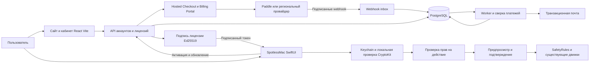
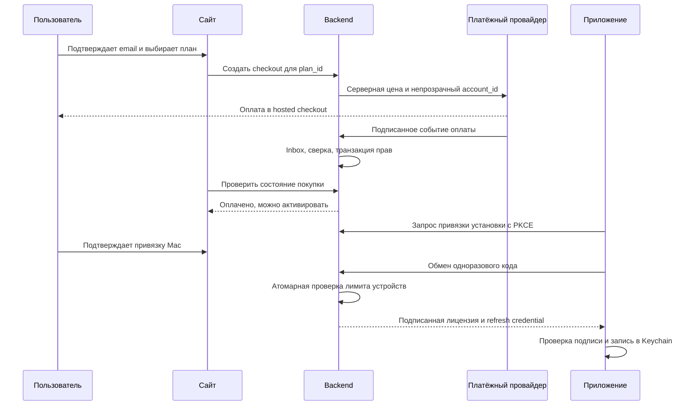

# Архитектура лицензирования SpotlessMac

Дата: 16 октября 2026. Статус: проект решения для реализации. Основание: исходники репозитория на коммите `bd7475a`, правила `AGENTS.md`, документация провайдеров. Тарифы, позиционирование и план продаж — в [маркетинговой стратегии](2026-10-16-marketing-strategy.md).

Рекомендуется собственный небольшой сервис прав доступа с подписанными офлайн-лицензиями и внешним платёжным провайдером. Для международного запуска основной кандидат — Paddle, уже указанный в макете сайта. Приложение сохраняет локальную обработку файлов; сервер отвечает за покупки, подписки, активации и выдачу лицензий.

## 1. Исходное состояние и границы

| Сейчас | Последствие для реализации |
|---|---|
| [LicenseManager](../../SpotlessMac/Licensing/LicenseManager.swift): одна бесплатная очистка, затем `activated(email)` | Сохранить бесплатный первый результат; добавить состояния срока, обновления и отзыва лицензии |
| [LicenseValidator](../../SpotlessMac/Licensing/LicenseValidator.swift): Ed25519, payload `email\|spotlessmac-v1\|date` | Дата выдачи не ограничивает срок; этот формат сам по себе не поддерживает подписку |
| [KeychainStore](../../SpotlessMac/Licensing/KeychainStore.swift): ключ и счётчик пробных очисток | Использовать Keychain и для новой лицензии, ключа установки и refresh credential; начать обрабатывать ошибки записи |
| [ActivationView](../../SpotlessMac/App/ActivationView.swift): ввод ключа, заглушка магазина | Добавить покупку и вход через браузер; поддержать восстановление покупки |
| [Сайт](../../website/README.md): React/Vite, кабинет — демонстрация | Сохранить frontend, подключить API и реальные сессии; макет не является биллингом |
| [LicenseManagerTests](../../SpotlessMacTests/LicenseManagerTests.swift): проверка общей политики доступа | Расширить проверками срока, подписи, устройств, отказов сети и миграции |

Проектируемый сервис не получает файловые пути, результаты сканирования, список процессов или содержимое диска. LLM-соединение остаётся отдельной функцией приложения с собственными настройками и согласием пользователя. Лицензия разрешает коммерческую функцию, но не делает операцию безопасной: whitelist, предпросмотр, проверка активности и `SafetyRules` остаются обязательными.

В исходниках есть существенное расхождение: [DockerClient](../../SpotlessMac/Docker/DockerClient.swift) использует Docker CLI `rm`/`prune`, тогда как `AGENTS.md` требует удаления только через Корзину. Эта архитектура не вводит исключение из правила. В предлагаемом первом коммерческом релизе диагностика Docker доступна; разрушительные Docker-действия не входят в обещанный набор до отдельного согласования политики и приёмки. Требуется явно решить это расхождение перед выпуском, а не считать существующий код разрешением.

## 2. Выбор подхода

| Подход | Преимущества | Ограничения | Решение |
|---|---|---|---|
| Paddle + собственный сервис лицензий | Собственные правила офлайн-работы, перенос старых ключей, контроль устройств, независимый формат лицензии | Нужно поддерживать API и БД | Основной вариант после одобрения продавца |
| Lemon Squeezy + его License API | Готовое управление ключами, проще первоначальная выдача | Для собственного офлайн-токена, миграции и единой модели прав всё равно нужен адаптер | Резервный вариант, если подходит продавцу и рынкам |
| Прямой эквайринг + собственный биллинг | Возможность отдельного регионального контура | Больше работы с рекуррентными платежами, чеками, возвратами и налогами | Для рынка, который MoR не обслуживает; не первый международный вариант |

Paddle публикует ставку **5% + $0.50 за checkout-транзакцию**. Lemon Squeezy публикует такую же базовую ставку, но отдельно указывает доплаты за подписки и некоторые способы/географию платежей. Комиссию следует моделировать по фактическому договору и налогооблагаемой сумме заказа. [Paddle pricing](https://www.paddle.com/pricing), [Lemon Squeezy fees](https://docs.lemonsqueezy.com/help/getting-started/fees).

Владелец планирует иностранную компанию, доступную российскому учредителю, и worldwide-продажи; конкретные юрисдикция, резидентство и место деятельности ещё не определены. Paddle не обслуживает поставщиков, работающих из перечисленных неподдерживаемых стран, включая Россию; ограничения есть и для покупателей. Lemon Squeezy также указывает РФ среди стран, из которых нельзя принимать покупки. Международная схема условна до onboarding с раскрытием реального владельца и места деятельности; зарубежной регистрации самой по себе недостаточно. Для российского контура возможен отдельный адаптер, например к ЮKassa с автоплатежами, после подтверждения условий подключения, рекуррентных списаний и фискализации. Поддержка провайдера определяется отдельно для продавца и покупателей. [Paddle countries](https://www.paddle.com/help/legal/sanctions/which-countries-are-supported-by-paddle), [Lemon Squeezy countries](https://docs.lemonsqueezy.com/help/getting-started/supported-countries), [ЮKassa автоплатежи](https://yookassa.ru/developers/payment-acceptance/scenario-extensions/recurring-payments/basics).

## 3. Схема компонентов

Для MVP это один backend-проект, два процесса — API и worker — и PostgreSQL. Signer является изолированным модулем worker/API с отдельным секретом, а не обязательным сетевым микросервисом. На схеме показаны логические границы. Отдельные Redis, Kafka и Kubernetes для начальной нагрузки не требуются.

### Стек и инструменты

| Область | Выбор | Причина |
|---|---|---|
| Клиент | Swift 6, SwiftUI, URLSession, CryptoKit, Keychain | Продолжение существующей архитектуры |
| Backend | Поддерживаемый Node.js LTS, TypeScript, Fastify, JSON Schema | Один язык с веб-проектом, валидация контрактов, небольшой API |
| Данные | Поддерживаемый PostgreSQL, SQL-миграции через Drizzle | Транзакции, уникальные ограничения, блокировка строк для лимитов устройств |
| Задачи | pg-boss и transactional outbox | Фоновые письма, retry, сверка; очередь использует PostgreSQL |
| Биллинг | Paddle API/официальный Node SDK, hosted checkout и portal | Платёжные реквизиты обрабатывает провайдер |
| Подпись | Ed25519 через `node:crypto`, проверка CryptoKit | Совместимо с уже используемым семейством ключей |
| Кабинет | Существующие React/Vite + серверные cookie-сессии | Не требуется переписывать сайт на другой framework |
| Доставка | Docker; управляемый хостинг контейнеров либо имеющийся Dokploy | Воспроизводимый deploy API/worker; PostgreSQL предпочтительно с управляемыми резервными копиями |
| CI | GitHub Actions, Vitest, интеграционные тесты PostgreSQL, XCTest | Проверки backend и клиентского формата лицензии |
| Наблюдаемость | Структурированные журналы, Sentry с очисткой данных, uptime check | Ошибки активаций, задержки webhook, очередь и доступность |
| Email | Транзакционный SMTP/API-провайдер с SPF/DKIM/DMARC | Вход, подтверждение покупки, сбои оплаты; доступность зависит от страны |

Конкретные версии фиксируются lockfile при реализации после проверки совместимости. Основа технического выбора: [Fastify](https://fastify.dev/docs/latest/), [Node crypto](https://nodejs.org/api/crypto.html), [Apple CryptoKit](https://developer.apple.com/documentation/cryptokit/curve25519/signing), [pg-boss](https://github.com/timgit/pg-boss), [PostgreSQL locking](https://www.postgresql.org/docs/current/explicit-locking.html). Выбор композиции компонентов — проектное решение, а не рекомендация этих поставщиков.

## 4. Покупка и первая активация

1. Бесплатное сканирование и первая очистка работают без регистрации и карты. Аккаунт нужен при покупке или восстановлении покупки.
2. Сервер сопоставляет внутренний `plan_id` с разрешённым provider price ID. Ни цена, ни срок, ни feature flags из браузера не становятся доверенными значениями.
3. Привязка checkout к аккаунту задаётся сервером. Для будущего guest checkout потребуется подтверждение адреса; одного введённого email недостаточно для получения чужой покупки.
4. Redirect «успешная оплата» показывает «Проверяем платёж», пока сервер не подтвердил оплату. Он не выдаёт права.
5. Платёж считается основанием доступа после проверки успешного финансового события и связи transaction → subscription → account. Одного `subscription.created` недостаточно.
6. Если событие задержалось, backend сверяет конкретную транзакцию через API провайдера и запускает ту же идемпотентную обработку. Повторная покупка не требуется.
7. Установка создаёт случайный ID и ключевую пару устройства в Keychain. Привязка идёт через системный браузер, одноразовый код, `state` и PKCE. В deep link не передаётся постоянный секрет.
8. Успех активации показывается после проверки токена и успешного сохранения. Ошибка Keychain оставляет понятный повторяемый сценарий, а не фиктивную активацию.

Для веб-входа: одноразовая email-ссылка с коротким сроком, хранение только хэша токена, подтверждающий POST после открытия, чтобы сканер почтовых ссылок не использовал токен. Сессия — `HttpOnly`, `Secure`, `SameSite`, защита CSRF для изменений. Ограничение частоты запросов и одинаковые внешние ответы для существующего/несуществующего email. Административный вход — отдельный, с MFA.

## 5. Модель данных и API

| Сущность | Основные поля и ограничения |
|---|---|
| `accounts` | UUID, verified email, timestamps; уникальный нормализованный email |
| `billing_customers` | account_id, provider, external_customer_id; уникальная пара provider/external ID |
| `plans` | стабильный code, device_limit, entitlements; версии условий неизменяемы |
| `prices` | plan_id, provider_price_id, currency, interval; опубликованная цена не переписывает старый договор |
| `subscriptions` | provider ID, статус, paid_through, cancel_at, next_price_id, последнее состояние провайдера |
| `transactions` | provider ID, сумма в минимальных денежных единицах, currency, оплаченный интервал, refund/dispute state |
| `licenses` | account_id, subscription_id или legacy origin, права, revision, revoked_at |
| `activations` | license_id, installation_id, public_key, display_name, last_seen_at, revoked_at; уникальная активная установка на лицензию |
| `webhook_events` | provider + event_id UNIQUE, occurred_at, received_at, payload, processing state, attempts |
| `sessions` и `activation_requests` | хэши секретов, PKCE challenge, сроки, used_at |
| `outbox` и `audit_log` | идентификатор операции, тип действия, субъект; без ключей, токенов и карточных данных |

`paid_through` строится из подтверждённых оплаченных периодов с учётом возвратов, а не из очередной будущей даты выставления счёта. Состояния финансового провайдера и права продукта хранятся раздельно. Порядок валют и сумм не допускает float. Одна подписка на аккаунт на старте упрощает UX; схема допускает несколько независимых лицензий позднее.

| Endpoint | Назначение и авторизация |
|---|---|
| `POST /v1/auth/email/start`, `/confirm` | Запрос и подтверждение входа, rate limit, одноразовый токен |
| `GET /v1/me` | Аккаунт, подписка, права; cookie-сессия |
| `POST /v1/checkouts` | Создание оплаты по серверному каталогу; сессия + Idempotency-Key |
| `POST /v1/billing/portal` | Временная ссылка только для customer текущего аккаунта |
| `POST /v1/webhooks/paddle` | Raw body, проверка подписи; пользовательская сессия не требуется |
| `POST /v1/activation-requests` | Создание запроса привязки устройства, короткий TTL |
| `POST /v1/activation-requests/{id}/approve` | Подтверждение владельцем через авторизованный браузер |
| `POST /v1/activations/exchange` | Одноразовый код + PKCE + доказательство владения ключом установки |
| `POST /v1/licenses/refresh` | Rotating refresh credential, привязанный к ключу установки |
| `GET /v1/activations` | Список своих Mac |
| `POST /v1/activations/{id}/revoke` | Освобождение слота владельцем; повторный запрос безопасен |
| `POST /v1/licenses/legacy/claim` | Отдельная миграция старой лицензии, без перевода в подписку |

Названия endpoint — предлагаемый контракт, а не существующая реализация. Для операций со сменой состояния нужны idempotency и проверка владельца объекта на сервере. Активация делает `SELECT ... FOR UPDATE` по лицензии, считает активные слоты и создаёт запись в одной транзакции. Два одновременных запроса на последний слот не могут оба пройти. Повтор той же установки возвращает существующую активацию.

Кабинет показывает устройства, статус, дату следующего списания/окончания и кнопку отмены. Платёжную карту, счета и cancellation обслуживает hosted portal; ссылку получают заново при каждом открытии и не сохраняют в логах. [Paddle customer portal](https://developer.paddle.com/build/customers/integrate-customer-portal/).

## 6. Подписанная лицензия и работа без сети

Новый формат — `SM2.<base64url(JSON bytes)>.<base64url(signature)>`. Подписываются точные байты `SM2.` плюс текст второй части. Клиент сначала проверяет Ed25519, затем разбирает JSON; повторная сериализация JSON для проверки подписи не используется. Поле `kid` допускает только встроенный доверенный набор публичных ключей, не URL из токена. Алгоритм фиксирован протоколом, переключения на `none` нет.

| Поле | Значение |
|---|---|
| `version`, `kid`, `license_id`, `revision` | Версия формата, ключ подписи и ревизия лицензии |
| `product_id`, `audience`, `environment` | Привязка к SpotlessMac и production; sandbox-токены не подходят Release |
| `activation_id`, `device_key_hash` | Привязка к конкретной установке |
| `plan_code`, `entitlements`, `device_limit` | Права продукта; стартовые Pro-планы отличаются числом Mac |
| `issued_at`, `refresh_after`, `expires_at`, `offline_until` | Серверные временные границы, UTC epoch seconds |
| `paid_through` | Конец подтверждённого оплаченного периода |
| `billing_grace_until` | Только для явно предоставленной сервером отсрочки оплаты |

Email не нужен в подписанном токене и может отображаться отдельно из профиля. Публичный ключ подписи поставляется в приложении, приватный — только серверный secret вне репозитория, frontend bundle, Docker image и журналов. Test и production используют разные ключи и базы. Для ротации сначала выпускается приложение, доверяющее новому публичному ключу, затем переключается signer; старый ключ сохраняется на время действующих токенов. Старые бессрочные ключи обслуживаются отдельной веткой совместимости.

Предлагаемая политика:

- Обновлять токен в фоне раз в 24 часа и при возвращении приложения в активное состояние, с jitter, таймаутом и exponential backoff.
- `expires_at = min(issued_at + 7 суток, paid_through)`; при временной недоступности сети допускается работа до `offline_until = min(expires_at + 3 суток, paid_through)`. Таким образом максимум без успешного обновления — 10 суток, но оплаченный срок не продлевается автоматически.
- После неуспешного продления сервер может выдать отдельную отсрочку до **первоначального** `paid_through + 72 часа`. Повторные запросы не сдвигают этот предел. Без связи получить новую отсрочку нельзя.
- По истечении предела остаются сканирование, просмотр, сведения о подписке и восстановление покупки. Новые платные очистки недоступны; файлы и результаты не удаляются.
- Ответ сервера об отзыве не равен сетевой ошибке: он немедленно запрещает новые платные операции и сохраняется локально. Возврат к старому кэшированному токену после известного отзыва запрещён.
- Уже подтверждённая и начатая операция завершается по сохранённому разрешению; истечение лицензии не обрывает её посередине. Отмена пользователем и safety-проверки продолжают действовать.

Для проверки устройства refresh-запрос доказывает владение приватным ключом установки, подписывая серверный nonce и параметры запроса. Refresh credential ротируется, хранится хэшированным на сервере и имеет отдельный срок. Конкретный signing format фиксируется контрактными тестами до реализации клиента.

Откат системных часов обнаруживается по последнему доверенному серверному времени, сохранённой максимальной дате и монотонному времени внутри процесса; сомнительный случай требует соединения, а не пожизненной блокировки. Полностью исключить модификацию локального приложения или копирование состояния на подконтрольной пользователю машине нельзя. Подпись и устройства ограничивают случайное распространение лицензий; взломоустойчивость не является обещанием продукта.

Отзыв и перенос устройства имеют неизбежную офлайн-задержку: уже выданный токен может действовать до своего `offline_until`, максимум 10 суток и не позже оплаченной границы. После деактивации новый Mac получает слот сразу, старый теряет права при следующей связи либо истечении токена. Это осознанный компромисс в пользу работы без постоянного интернета.

## 7. Состояния подписки

| Событие/состояние | Поведение |
|---|---|
| Free, первый цикл не использован | Одна подтверждённая файловая очистка; чтение без ограничения |
| Первая покупка pending/failed | Остаётся прежний доступ; «оплачено» не показывается |
| Платёж подтверждён | Pro до оплаченного срока, выдача токена |
| Отменено автопродление | Pro до paid_through; дата окончания показана явно |
| Продление успешно | paid_through продлевается по оплаченному интервалу |
| Продление не прошло | Предложить обновить карту; серверная billing grace 72 часа, затем Free |
| Подписка закончилась | Free; использованная пробная очистка не восстанавливается |
| Полный возврат оплаченного периода | Отзыв прав этого периода; пересчёт оставшегося покрытия, если были другие платежи |
| Частичный возврат | Пересчёт по явно заданной политике; не отзывать весь аккаунт автоматически |
| Dispute/chargeback | Приостановка прав затронутой покупки с возможностью поддержки; сверка результата спора |
| Upgrade 1 → 3 Mac | После успешной доплаты; слот не выдаётся по browser callback |
| Downgrade 3 → 1 Mac | Со следующего периода; заранее выбрать сохраняемый Mac, иначе сохранить последний активный и уведомить |
| Месяц → год или обратно | Со следующей границы периода на старте, без сложного перерасчёта |

Финансовые операции различаются: «отменить автопродление», «вернуть деньги» и «отозвать устройство» не должны вызывать друг друга. Ручные действия поддержки фиксируются в audit log.

## 8. Webhook, сверка и отказоустойчивость

Webhook проверяется по **исходному телу запроса** и `Paddle-Signature` до JSON-преобразований. Сохраняются event ID и payload, затем возвращается 200; бизнес-обработка выполняется worker. Если durable-запись не удалась, вернуть ошибку для повторной доставки. Paddle допускает дубликаты и события не по порядку: ключ дедупликации — `event_id`, порядок оценивается по `occurred_at`, не по моменту получения. [Проверка подписи](https://developer.paddle.com/webhooks/about/signature-verification/), [доставка событий](https://developer.paddle.com/webhooks/about/how-webhooks-work/).

В одной транзакции worker обновляет финансовую запись, проекцию прав и outbox. Уникальный event ID предотвращает повторную обработку, но сам по себе не решает устаревшее состояние: для неоднозначных или запоздавших событий worker запрашивает актуальную subscription/transaction, учитывает refund/dispute ledger и сериализует изменения по подписке. Старое `active` не может отменить уже подтверждённый refund.

Сверка: проблемные операции каждые 15 минут, все действующие подписки раз в сутки с пагинацией и учётом API limits. Периодический replay ищет события, потерянные после исчерпания retry. Ошибки попадают в очередь ручного разбора; поддержка видит payment ID и причину, но не секреты.

Цели MVP, которые ещё нужно подтвердить нагрузочной проверкой: 99.9% месячной доступности API, p95 refresh <500 мс без обращения к платёжному провайдеру, права доступны в течение 60 секунд после обработки подтверждённой оплаты. Офлайн-лицензия защищает уже активированных клиентов от кратких сбоев. Первую активацию без доступного сервиса выполнить нельзя.

Резервирование: ежедневная зашифрованная копия + PITR с целевым RPO ≤1 часа, RTO ≤4 часов; ежемесячное пробное восстановление. Если выбранный хостинг не поддерживает эти параметры, это явное ограничение запуска, а не выполненная гарантия. Триггеры оповещения: backlog старше 5 минут, всплеск 5xx/ошибок подписи, несверенные платежи, неудачный backup, аномальный рост активаций.

## 9. Интеграция с приложением и миграция

Добавить `LicenseService` actor для сети и `EntitlementPolicy` как чистую функцию. `LicenseManager` остаётся `@Observable @MainActor` и отображает состояние. View не рассчитывает цену, срок и доступ самостоятельно. Разрешение выдаётся на действие через единый admission flow; затем существующие движки отдельно проверяют безопасность файлов.

Проверить все входы: Smart Care, обычная очистка, крупные файлы, очистка кэша приложения, деинсталляция, Agent Storage и любые будущие действия. Один общий счётчик пробного цикла резервируется атомарно, чтобы два окна не выполнили две бесплатные очистки. Расходуется ровно один раз, если хотя бы один объект успешно обработан; нулевой результат, отказ доступа и отмена до первого успеха не расходуют попытку. Для аварийного завершения хранить operation ID и состояние резерва; после перезапуска не запускать удаление повторно автоматически.

Бесплатная попытка предназначена для файловых операций через Корзину. Docker CLI не должен расходовать её в предлагаемом выпуске. Диагностика памяти и явное пользовательское завершение приложений остаются бесплатными; ассистент по-прежнему не получает API удаления, запуска процессов или завершения приложений.

`#if DEBUG` bypass сохраняется в установленном виде. Чистая production-policy тестируется отдельно; обязательна проверка **Release**, чтобы Debug не скрывал ошибки лицензирования. Новые платные флаги должны проходить ту же явно ограниченную Debug-политику, без release environment overrides.

Старые ключи `spotlessmac-v1` продолжают проверяться отдельно. Нельзя задним числом назначить им срок или уменьшить ранее проданные права. При добровольной привязке сервер проверяет подпись, подтверждает владение аккаунтом и создаёт legacy entitlement с уникальным хэшем ключа. Если email ключа недоступен, предусмотрен ручной перенос по доказательству покупки. Обещанный старой покупкой срок обновлений сохраняется по фактическим условиям продажи; при отсутствии реестра выдач сначала восстановить его из платежей. Старый формат не даёт доказательства числа разрешённых устройств — это нельзя выдумать при миграции.

## 10. План реализации и приёмки

Оценка для одного опытного full-stack разработчика с доступом к Swift-коду: **5–7 инженерных недель** без ожидания onboarding провайдера и без маркетинговой работы. Это оценка, не обещание календарного срока.

| Этап | Результат | Проверка |
|---|---|---|
| 1. Договор и контракт, 3–5 дней | Подтверждённый провайдер, финальные SKU, спецификация токена и матрица прав | Одинаковые условия на сайте, в checkout и приложении |
| 2. Backend и webhooks, 5–7 дней | БД, аккаунты, checkout, inbox/outbox, сверка | Дубли, задержки, reordered events, refund не создают лишних прав |
| 3. Клиент и устройства, 5–7 дней | PKCE, токен, Keychain, refresh, управление Mac, legacy | Копирование на другой Mac, неверная подпись, лимиты, отзыв, сеть и часы |
| 4. Кабинет и переходы, 4–6 дней | Portal, отмена, downgrade, восстановление, поддержка | End-to-end sandbox: купить → активировать → продлить → отменить → истечь |
| 5. Приёмка и пилот, 5–7 дней | Release, наблюдаемость, backups, инструкции поддержки | Матрица ниже, пробное восстановление и ограниченный пилот |

Обязательная матрица до первых продаж:

- Несовпадение product/environment, неизвестный kid, повреждённая подпись и JSON, будущий issued_at, истёкшая лицензия.
- Сеть недоступна до/после 7 и 10 суток; граница paid_through; отсрочка оплаты не продлевается повторными refresh.
- Одновременные активации последнего слота, повтор запроса, перенос, деактивация без доступа к старому Mac.
- Дубли/изменённая подпись webhook, событие отмены перед событием оплаты, refund перед запоздавшим active, потерянный webhook и успешная сверка.
- Ошибка Keychain, переустановка, истёкший email/activation code, PKCE mismatch, доступ к чужой subscription.
- Один бесплатный успешный цикл во всех файловых входах; частичный успех учитывается один раз; нет повторного удаления после crash.
- Действительная старая лицензия сохраняет прежние права; Debug bypass работает только в Debug; чистая policy и Release проверены.
- `AssistantIsolationTests`, safety, preview и проверки путей проходят без ослабления. Изменение тарифа не расширяет whitelist.
- Реальный покупательский пилот проверяет письмо, портал, отмену и возврат по утверждённой процедуре; используются отдельные тестовые данные.

Планируемые эксплуатационные расходы при небольшой базе: **$50–150/месяц** на API/worker, БД с backups, почту и мониторинг, плюс комиссия платежей и домен. Это бюджетная гипотеза для выбора конкретных поставщиков; разработка, поддержка, реклама и расходы продавца сюда не входят.

Следующие решения владельца продукта: подтвердить географию продавца и покупателей; принять стартовые тарифы; разрешить расхождение Docker-политики; определить фактические права ранее выданных лицензий. До этого архитектуру можно реализовывать в sandbox, но подключение коммерческого checkout требует подтверждённых условий продавца.
